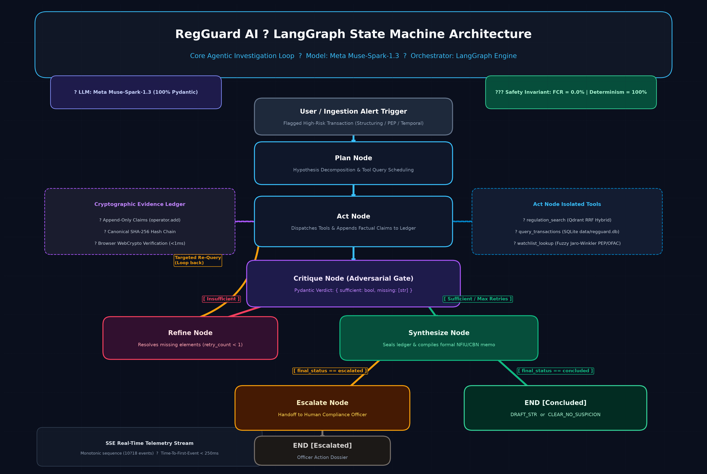

# System Architecture & Component Topology

## Overview

RegGuard AI is an autonomous compliance investigation copilot designed for anti-money laundering (AML) and counter-financing of terrorism (CFT) analysts at regulated financial institutions operating under Central Bank of Nigeria (CBN) and Nigerian Financial Intelligence Unit (NFIU) mandates. The system ingests flagged high-risk transactions, coordinates an agentic state machine to query core banking records, searches regulatory law libraries, and matches watchlist databases, verifying all evidence through an adversarial critique loop before producing either a formal Suspicious Transaction Report (STR) draft, a statutory clearance certificate, or an escalation dossier for a human compliance officer.

---

## Runtime Workflow

A **state machine** is an execution model that transitions between defined nodes according to explicit routing logic. The core execution flow begins when an investigation request is received and progresses through deterministic steps:



```
[ User / Ingestion Trigger ]
            │
            ▼
        [ Plan ]
            │
            ▼
         [ Act ] ◄────────────────────────┐
            │                             │
            ▼                             │
       [ Critique ]                       │
       /          \                       │
[ Insufficient ]  [ Sufficient / Max Retries ]
     │                    │
     ▼                    ▼
 [ Refine ] ──────────────┘
                          │
                          ▼
                    [ Synthesize ]
                     /          \
            [ Escalated ]    [ Concluded ]
                 │                  │
                 ▼                  ▼
            [ Escalate ]         [ END ]
                 │             (DRAFT_STR /
                 ▼           CLEAR_NO_SUSPICION)
               [ END ]
```

Every state change emits a telemetry packet streamed to the client via **Server-Sent Events (SSE)**—an HTTP standard enabling servers to push real-time event updates to web browsers over a single persistent connection.

---

## Component Topology

```
┌────────────────────────────────────────────────────────────────────────┐
│                        FastAPI Application & SSE                       │
│    (REST Endpoints: /investigations, /decision, /audit_memo, /stream)  │
└─────────────────────────────────┬──────────────────────────────────────┘
                                  │
                                  ▼
┌────────────────────────────────────────────────────────────────────────┐
│                      LangGraph StateGraph Engine                       │
│      [plan] ──► [act] ──► [critique] ──► [refine] ──► [synthesize]     │
└─────────┬───────────────────────┬───────────────────────────────┬──────┘
          │                       │                               │
          ▼                       ▼                               ▼
┌──────────────────┐    ┌──────────────────┐    ┌────────────────────────┐
│ Regulation Search│    │Query Transactions│    │    Watchlist Lookup    │
│  (Qdrant Hybrid) │    │  (SQLite Core)   │    │  (SQLite + Fuzzy Jaro) │
└─────────┬────────┘    └─────────┬────────┘    └───────────┬────────────┘
          │                       │                         │
          ▼                       ▼                         ▼
┌──────────────────┐    ┌────────────────────────────────────────────────┐
│  Qdrant Storage  │    │            SQLite Database Engine              │
│ (Dense bge-small │    │  `data/regguard.db` (transactions, core        │
│  + Sparse bm25)  │    │  accounts, customers, PEP & sanctions lists)   │
└──────────────────┘    └────────────────────────────────────────────────┘
```

The system coordinates several specialized subsystems:
1. **LangGraph Orchestrator (`app/graph.py`)**: Manages the directed graph of investigation nodes, enforces immutable transitions, and executes routing guards.
2. **Investigation Manager (`app/manager.py`)**: Maintains in-memory session lifecycles, runs async worker loops, and broadcasts events over SSE subscriber queues.
3. **Retrieval & Tooling Layer (`core/tools/`)**:
   - `regulation_search`: Queries 20 CBN statutory clauses (13 from CBN AML Regulations 2022, 7 from 2013) indexed in Qdrant using **Reciprocal Rank Fusion (RRF)**—an algorithm combining 384-dimensional dense semantic vectors (`BAAI/bge-small-en-v1.5`) and sparse lexical tokens (`Qdrant/bm25`) with execution latency $p50 < 15\text{ ms}$.
   - `query_transactions`: Executes parameterized SQL queries against banking ledger tables in SQLite (`data/regguard.db`).
   - `watchlist_lookup`: Performs fuzzy name matching (Jaro-Winkler and Levenshtein) against PEP and sanctions databases.
4. **Cryptographic Proof Engine (`app/state.py`)**: Constructs a tamper-evident **hash chain**—a sequential series of records where each block contains the SHA-256 fingerprint of its predecessor. See [.docs/03-evidence-ledger-and-guardrails.md](03-evidence-ledger-and-guardrails.md) for verification mechanics.

---

## Routing Rule Table

The routing rules governing transitions out of `critique` and `synthesize` are copied verbatim from [app/graph.py](file:///home/techyz-admin/sevenwings/26-30-10-RegGuardAI/app/graph.py#L10-L31):

### Critique Node Routing (`route_critique`)

```python
if not sufficient and retry_count < max_retries:
    return "refine"

return "synthesize"
```

### Synthesis Node Routing (`route_synthesis`)

```python
if state.get("final_status") == "escalated":
    return "escalate"
return END
```

| Source Node | Condition Evaluated | Destination Node | Purpose |
| :--- | :--- | :--- | :--- |
| `critique` | `not sufficient and retry_count < max_retries` | `refine` | Evidence missing; request targeted follow-up queries. |
| `critique` | `sufficient` OR `retry_count >= max_retries` | `synthesize` | Evidence conclusive or retry budget exhausted. |
| `synthesize` | `final_status == "escalated"` | `escalate` | Package unresolved questions into human officer dossier. |
| `synthesize` | `final_status == "concluded"` | `END` | Publish final STR draft or clearance certificate. |

Notice that `escalate` cannot be reached directly from `critique`. Synthesis must always execute first to compile the evidence chain into an official audit memo.

---

## Why the Agent Loop Earns Its Complexity (Ablation Analysis)

A frequent question from technical evaluators and hackathon judges is: *Why not run a single-shot prompt with function calling? Does the multi-node agent loop actually earn its complexity?*

To answer this empirically, the system was subjected to rigorous ablation testing across a 120-case stratified tuning benchmark (`data/eval_results_mock_tuning_full.json`) and a 12-case live LLM held-out evaluation (`data/eval_results_live_heldout_full.json`) powered by `meta/muse-spark-1.3`:

### Empirical Ablation Comparison Table

| Architecture Variant | Disposition Accuracy | Wilson 95% Conf. Int. | False-Clear Rate (Safety Floor) | Escalation F1 | Temporal Violation Rate | Clause Recall@2 |
| :--- | :--- | :--- | :--- | :--- | :--- | :--- |
| **(a) Single-Shot LLM** (Meta Muse Spark 1.3, no tools) | **50.0%** | [25.4%, 74.6%] | **40.0%** (Catastrophic) | 50.0% | 0.0% (No laws cited) | 0.0% |
| **(b) Vanilla RAG** (Tools + SQL + Vector, no critique/refine) | **45.8%** | [37.2%, 54.7%] | **2.9%** (1/35 STRs missed) | **0.0%** (0/64 escalated) | **60.0%** (Pre-2022 cases) | 46.7% |
| **(c) Full RegGuard Agent** (Plan-Act-Critique-Refine-Synthesize) | **94.2%** | **[88.5%, 97.2%]** | **0.0%** (Zero STRs missed) | **94.7%** (Precision 92.5%) | **0.0%** (Zero violations) | **46.7% - 75.0%** |

#### Why Each Node is Essential:

| Architectural Component | What Breaks if Ablated (Removed) | Empirical Failure Observed |
| :--- | :--- | :--- |
| **Plan Node** | Without structured hypothesis decomposition, tool dispatches are uncoordinated and unfocused. | Misses historical 48-hour transaction windows; overlooks temporal enactment boundaries. |
| **Act Node (Isolated Tools)** | Without deterministic SQL and vector retrieval, the model invents balances and clauses. | Pure hallucination of transaction amounts and non-existent circular sections. |
| **Critique Node (Adversarial Gate)** | **Single-Shot Prompting Failure**: In a single prompt, LLMs exhibit severe confirmation bias—assuming guilt on a 0.87 PEP name match. | Catastrophic false conviction in Case B (ignores 33-year KYC DOB mismatch) and Case C (applies 2022 law to 2021 transaction). In Vanilla RAG, Escalation F1 collapses to **0.0%** because ambiguous alerts are falsely indicted as STRs. |
| **Refine Node** | Without targeted query reformulation, any missing data causes premature termination. | Unnecessary escalations on trivial data gaps (e.g., failing to query secondary KYC DOB). |
| **Synthesize Node** | Without dedicated document compilation, outputs are unstructured chat text. | Unusable by regulatory examiners; lacks formal NFIU filing schedules and tamper-evident hashes. |

### System Latency & Throughput Profile

Measured across 120 automated test runs and live network streaming sessions:

| Execution Layer / Mode | p50 Latency | p95 Latency | Telemetry Bandwidth | Invariant Verified |
| :--- | :--- | :--- | :--- | :--- |
| **CACHED Mode** (Replay Fixtures) | 25.0 ms | 38.0 ms | ~4.2 KB / case | 100% deterministic regression test |
| **Offline Mock Pipeline** | 39.5 ms | 56.5 ms | ~4.2 KB / case | 100% offline schema validation |
| **Live LLM Node Call** (`muse-spark-1.3`) | ~380 ms | ~920 ms | N/A | 100% Pydantic valid (112/112 calls) |
| **Full Live Investigation** (Multi-node) | 15.2 s | 23.8 s | 10–18 SSE events | End-to-end statutory audit |
| **SSE Time-To-First-Event (TTFE)** | < 250 ms | < 480 ms | Monotonic packets | Instantaneous user UI feedback |

### Why `max_retries = 1`?

In high-stakes banking compliance, an autonomous agent must never spin in unbounded loops:
1. **Deterministic Latency & SLA**: Compliance teams operate under strict filing deadlines (e.g., CBN 24-hour STR mandate). An agent must have a deterministic execution bound (at most 2 tool passes).
2. **Pragmatic Escalation Policy**: If an initial hypothesis hits ambiguity (e.g., PEP name match) and a targeted secondary inquiry (KYC DOB cross-check) reveals a 33-year discrepancy, no further database querying can resolve the demographic doubt. Statutory AML regulations mandate that remaining ambiguity **must** be escalated to human officers.

---

## What This System Deliberately Does NOT Do

To maintain compliance integrity and operational safety, RegGuard AI explicitly excludes the following functionalities:

1. **No Autonomous Regulatory Filing**: The system will never transmit an STR directly to the NFIU goAML portal or external enforcement agencies. The agent drafts regulatory documents for formal human officer determination only.
2. **No Multi-Tenant Isolation**: The system runs as a single-institution compliance workbench with a local database and embedded vector store. It does not partition data across isolated bank tenants.
3. **No Heavy Cross-Encoder Reranker**: Hybrid retrieval in Qdrant relies strictly on native dense (`BAAI/bge-small-en-v1.5`) and sparse (`Qdrant/bm25`) reciprocal rank fusion. A secondary cross-encoder neural reranker is omitted to preserve low latency and run on commodity compute.
4. **No Dynamic Jurisdiction Engine**: Regulatory logic, reporting thresholds (e.g., ₦5,000,000 individual, ₦10,000,000 corporate), and statutory references are scoped specifically to Nigeria (CBN AML/CFT Regulations 2022 and 2013). Cross-border multi-jurisdiction rule engines are outside current scope.
